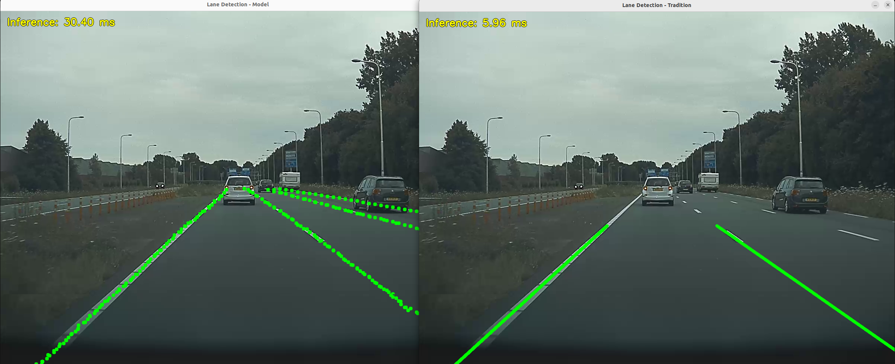
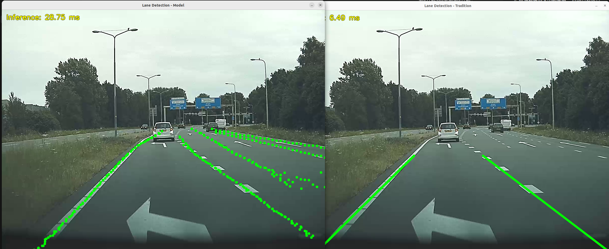
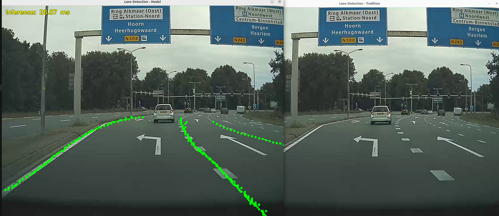
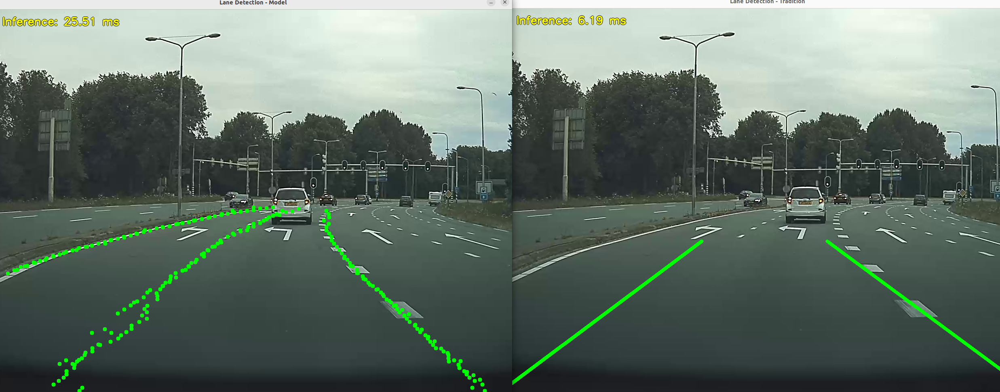

[](https://github.com/1egx/lane_detect)

# Lane Detection

基于 OpenCV 的传统车道线检测与基于 ONNX 模型的车道线检测实验。程序逐帧读取视频，可单独运行任一方法，也可同时打开两个窗口进行效果对比。

## 项目下载

项目已经上传至GitHub,地址为： https://github.com/1egx/lane_detect

```bash
git clone https://github.com/1egx/lane_detect.git
cd lane_detect
```

模型和测试视频通过外部链接提供，下载后按下面的目录放置：

- 模型：[下载 model.onnx](https://drive.google.com/file/d/1EiDwzmixOM9lf8sKE6jIBh3ku42dUu7I/view?usp=sharing)，放入 `models/model.onnx`。
- 测试视频：[下载测试视频](https://drive.google.com/drive/folders/17lU-uWaoSAdyHH8DT-WnekNgaa_PMO9H?usp=sharing)，例如放入 `videos/`。

运行模型模式时，程序会从相对路径 `models/model.onnx` 加载模型；请从项目根目录运行程序，或确保该相对路径可用。

## 依赖

### 必需

- C++ 编译器和 CMake。
- OpenCV 4.9.0 或更高版本，需包含项目使用的 `core`、`imgproc`、`highgui`、`videoio` 和 `dnn` 功能。
- 能够读取测试视频格式的 OpenCV `videoio` 后端。读取 MP4 通常需要带 FFmpeg 等相应视频解码支持的 OpenCV 构建。

### CUDA 推理

CMake 中 `ENABLE_CUDA` 默认为 `ON`，因此默认配置还会查找 CUDA Toolkit。要使用 GPU 推理，除 CUDA Toolkit 外，OpenCV 也必须构建并启用 DNN CUDA 后端；仅安装 NVIDIA 显卡驱动或 CUDA Toolkit，并不能保证当前 OpenCV 具备该能力。OpenCV 的 CUDA DNN 构建通常还需要兼容版本的 cuDNN。

项目的 CMake 配置没有单独查找或链接 cuDNN；cuDNN 是否需要安装，取决于所使用的 OpenCV CUDA 构建。若 OpenCV 没有 CUDA DNN 支持，程序运行时会尝试回退到 CPU，但默认构建仍要求 CUDA Toolkit。只使用 CPU 时，请按下文关闭 `ENABLE_CUDA`。

## 构建

默认配置（启用 CUDA 构建选项）：

```bash
cmake -S . -B build
cmake --build build
```

仅使用 CPU：

```bash
cmake -S . -B build -DENABLE_CUDA=OFF
cmake --build build
```

## 运行

```bash
./build/main <video_path> [--device GPU|CPU] [--method model|tradition|both]
```

例如：

```bash
./build/main ./videos/dashcam6.mp4 --device GPU --method both
```

参数说明：

| 参数 | 可选值 | 默认值 | 说明 |
| --- | --- | --- | --- |
| `--device` | `GPU`、`CPU` | `GPU` | 选择模型推理设备；传统算法不使用该选项。GPU 不可用时程序会尝试回退到 CPU。 |
| `--method` | `model`、`tradition`、`both` | `model` | 选择模型、传统算法或同时运行两种算法。`both` 会依次处理每帧，并分别显示结果窗口。 |

上述两个参数都是可选项，运行时可以不加入 `--device` 默认为 `GPU`，`--method` 默认为 `model`。视频地址为必选项。


## 算法流程

### 模型方法

1. 使用 OpenCV DNN 加载 `models/model.onnx`，根据 `--device` 选择 CUDA 或 CPU 后端。
2. 将输入帧缩放到 `1600 × 1000`，裁取底部 `1600 × 800` 区域，转换为 RGB 并按 ImageNet 均值和标准差归一化。
3. 执行网络推理，读取 `loc_row`、`loc_col`、`exist_row` 和 `exist_col` 四个输出张量。
4. 根据存在性分数筛选车道锚点，并将行、列方向的网格位置映射回原始帧坐标。每条车道输出一组点，而不是一条拟合后的线。
5. 在画面上绘制绿色点，并显示网络推理耗时。

### 传统方法

1. 根据整帧平均颜色粗略判断昼夜，再按阈值筛选白色、黄色候选；夜间额外筛选灰色候选。该判断是启发式的，容易受阴影、隧道和强光影响。
2. 将候选图像转为灰度图，进行 `3 × 3` 高斯平滑，再使用阈值为 `50` 和 `150` 的 Canny 算子提取边缘。
3. 使用梯形感兴趣区域（ROI）保留道路附近的边缘，减少画面其他区域的干扰。
4. 使用概率霍夫变换提取线段，再按斜率和画面位置划分左右线段，并分别用线性回归拟合左右边界。
5. 左右边界都有效时，使用卡尔曼滤波平滑端点，并将两条边界及中间区域绘制到画面上。若缺少任一侧，当前实现不会单独绘制另一侧。

传统方法依赖固定颜色阈值、ROI 和直线拟合；强反光、车道线缺失、道路弯曲或车道结构变化都可能降低检测效果。


### 示例画面

下图为模型（左）与传统方法（右）的并排结果示例。绿色点表示模型输出的车道点，绿色线表示传统方法拟合出的左右边界。

| 示例 | 对比结果 |
| --- | --- |
| 示例 1 |  |
| 示例 2 |  |
| 示例 3 |  |
| 示例 4 |  |

## 实验结果与分析

以下结果来自 Ubuntu 22.04、NVIDIA GeForce RTX 4060 Laptop 环境下的多次运行记录。其中模型是启用了GPU的CUDA加速，如果使用CPU运行，推理延迟高达300ms以上,没有实际意义。

| 方法 | 单帧耗时 | 主要特点 |
| --- | --- | --- |
| 模型方法 | 平均约 `28 ms`，最高约 `32 ms` | 对曲线、车道线局部缺失和道路结构变化的适应性较好；输出为多个车道点，复杂场景中也可能出现偶发漏识别。 |
| 传统方法 | 平均约 `10 ms`，最高约 `15 ms` | 计算开销较低；对清晰、近似直线的车道效果直观，但容易受颜色、光照、遮挡和固定 ROI 影响。 |

从示例图可以看到，两种方法在清晰道路上都能给出车道位置。模型方法以离散点表示检测结果，在弯道、路口或车道标线局部不连续时，仍能沿较复杂的形状给出点列；传统方法输出的是左右两条直线，显示更简洁，但直线模型难以贴合明显弯曲的道路，也无法充分表达多车道或路口扩展结构。

示例图二到四中可以看出，模型对于偶然的车道线缺失或者路口车道增多的部分，可以有效的进行识别并进行补齐，而传统识别则没有这种能力。经过实验，传统识别只能对距离较近的部分有较好的识别效果，一旦把识别距离拉远，如果远处是直道，拟合线条也许尚可。但如果是弯道，则会对识别效果有比较大的负面影响,而且当前使用的直线拟合无法对弯道进行有效的拟合。在距离较近的部分，由于弯道的曲率较小，直线拟合的结果可以近似表示弯道，但距离较远时，由于透视等原因，弯道曲率增大，则无法很好的进行拟合;对于本身曲率较大的弯道，近距离的传统识别效果也不好。

尝试将传统方法的直线拟合改为二次或更高阶多项式拟合后，曲线场景有所变化，但测试中未得到稳定、理想的改善，且可能损害直线路段的拟合效果。卡尔曼滤波则能缓和相邻视频帧之间边界位置的跳动；在当前实现中，它仅在左右两侧都检测成功时更新，因此无法弥补单侧检测缺失。

对于模型识别，普通车道识别的效果较好，对于车道短暂缺失或者路口扩展的补全性也较好，具有一定的鲁棒性。但是对于路口处的粗虚线或者与普通细车道具有明显差异的区域，可能会出现偶发漏检的情况。由于实际中车道不会突然消失，可以采用滤波的方式对于中间偶发漏检的帧的车道进行补全。